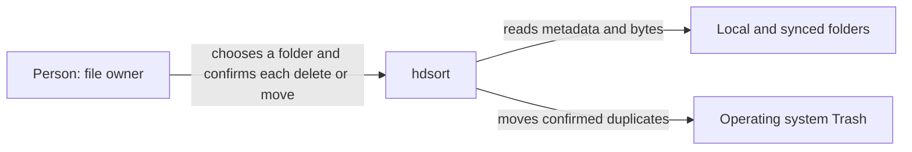
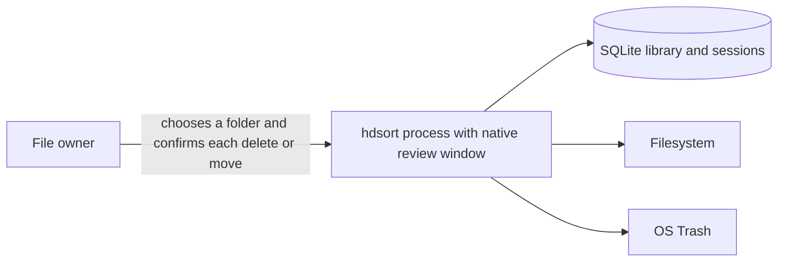
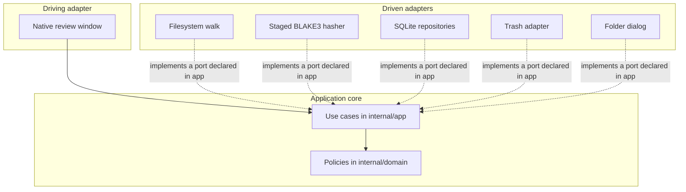
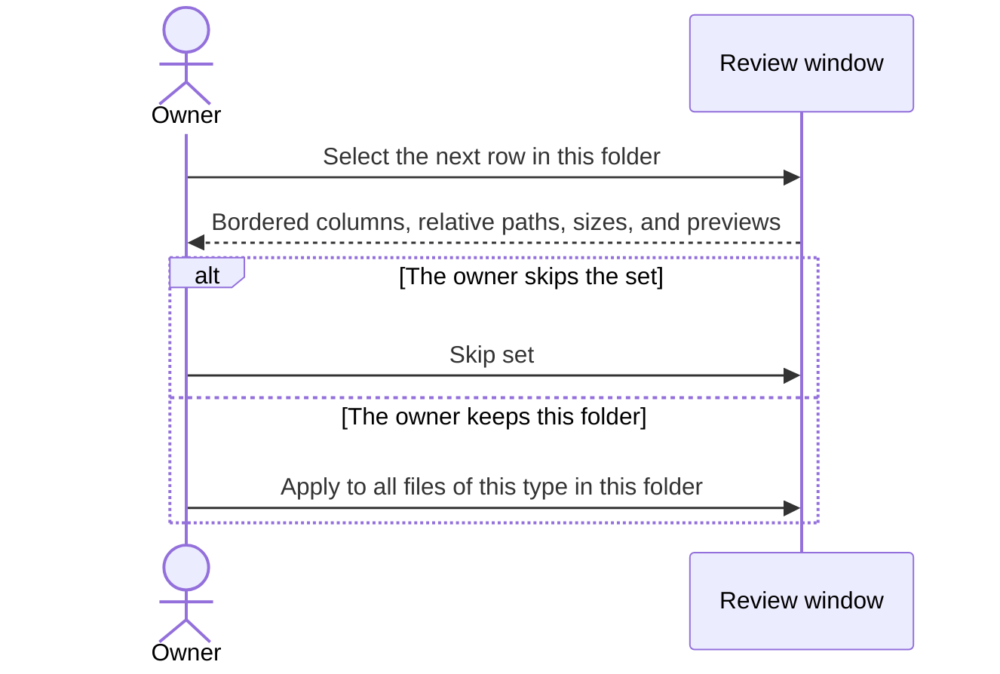
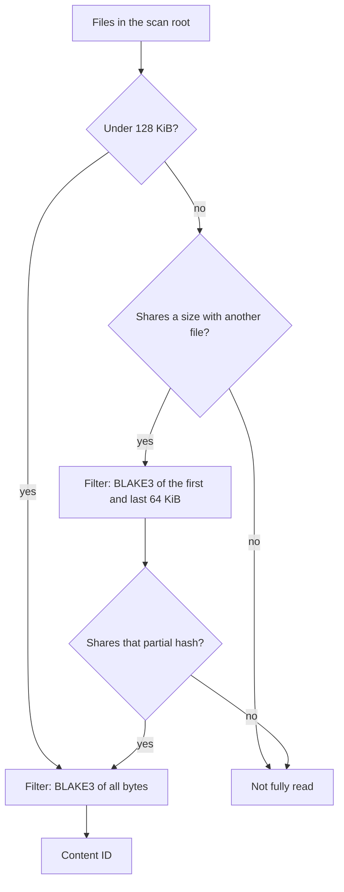
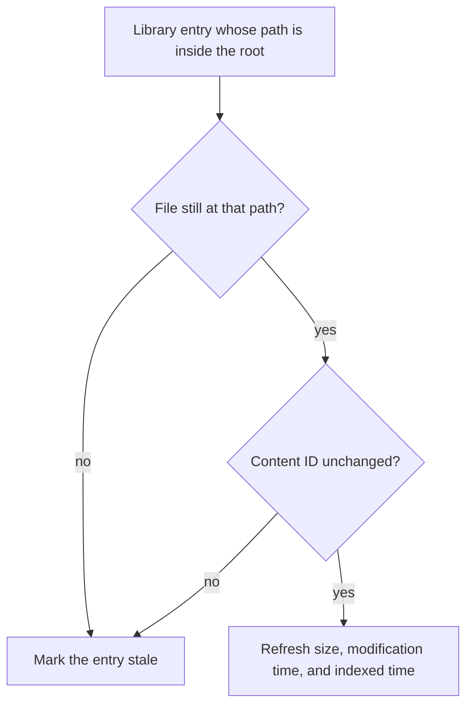
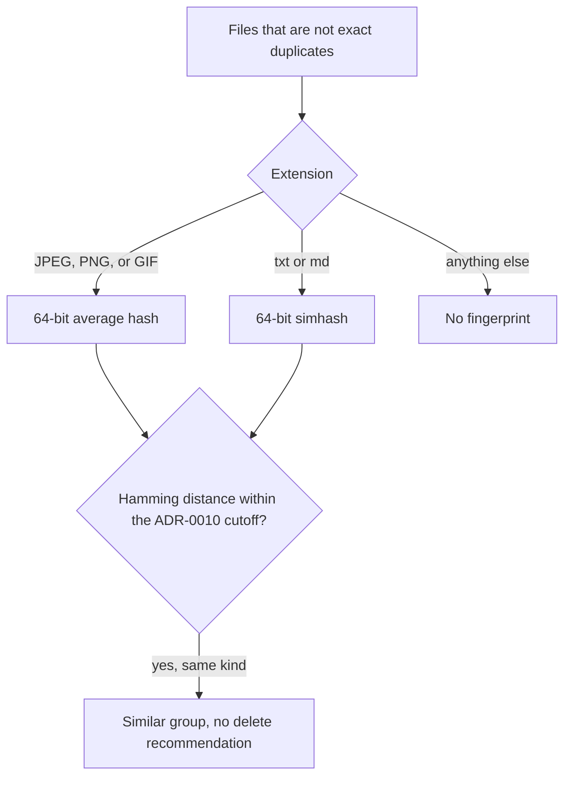
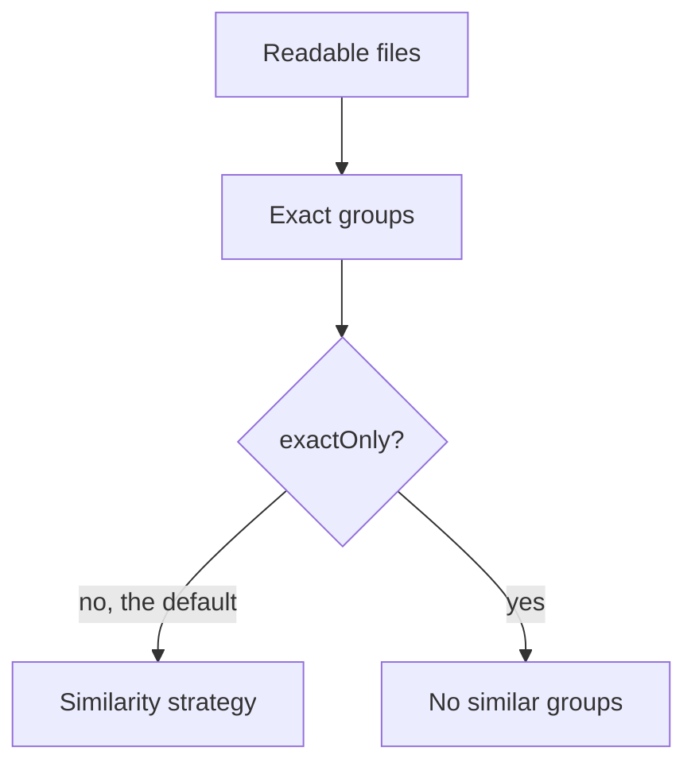
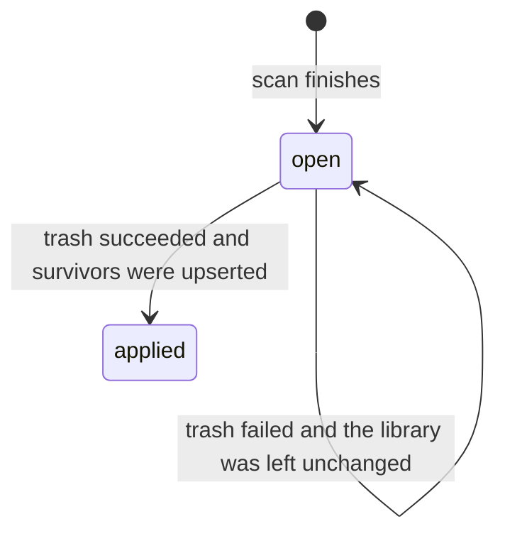

# Architecture

hdsort is a local program that scans a folder, finds duplicate files, asks the user before deleting anything, and records the files they kept. Later scans compare new folders with that record.

The skeleton, the domain model, content identity, the keeper policy, the SQLite library, apply, similar groups, and the native review window exist. Decisions are in `docs/adr/`. Patterns are the ones cited in `docs/patterns.md`.

## System context

One person uses hdsort on the computer where the files already are. Cloud copies participate only when a sync client has placed them on a local path. hdsort does not call a cloud provider API.

## Containers

The native review window is drawn by the Go process (ADR-0013). SQLite is the memory of survivors and of in-progress sessions.

The process does not listen and does not open a browser. A tag `vMAJOR.MINOR.PATCH` builds one binary for each of `darwin/amd64`, `darwin/arm64`, `linux/amd64`, `linux/arm64`, and `windows/amd64`, with cgo enabled, on a runner of that operating system (ADR-0012). The binary’s version is that tag. The macOS archive contains `hdsort.app` with that icon. The Windows executable embeds the same icon. The Linux archive carries the icon next to a desktop entry.

## Components

Ports and Adapters: the use cases sit in the middle, the native window drives them, and filesystem, hasher, SQLite, and Trash are driven adapters. The Dependency Rule puts `internal/domain` at the center. `cmd/hdsort` is the only composition root.

Compile-time dependencies point inward. Adapters import `internal/app` so they can implement the port interfaces the use cases declared. `internal/app` does not import an adapter. `internal/domain` imports only the standard library.

| Path | Role |
| --- | --- |
| `cmd/hdsort` | Composition root. Builds adapters and opens the native review window. |
| `internal/domain` | Content ID, groups, keeper ranking, plan checks, layout strategy results. Pure functions. |
| `internal/app` | Use cases: scan, reconcile, decide, apply, propose layout. Declares the port interfaces it calls. |
| `internal/adapters/filesystem` | Walk, skip rules, native folder dialog. |
| `internal/adapters/hash` | Size, partial BLAKE3, full BLAKE3. |
| `internal/adapters/similar` | Average hash for JPEG, PNG, and GIF. Simhash for `.txt` and `.md`. |
| `internal/adapters/sqlite` | `LibraryRepository` and `SessionRepository`. WAL mode. |
| `internal/adapters/trash` | Freedesktop Trash layout; macOS and Windows behind build tags. |
| `internal/adapters/gui` | Native review window. Gio draws it. The use cases do not import Gio. |
| `internal/adapters/http` | Loopback routes, cookie, and review page. Tested. The command does not start it. |

Port interfaces stay small and live next to the use case that calls them (Go Code Review Comments: the consumer owns the interface).

## Review window

The window keeps one list of duplicate sets. A file that is unique, a symlink, or a dataless placeholder is not listed. While a file is still being read it can appear; it leaves when the scan knows it is not a duplicate. An exact or similar group is one row, filed under the suggested keeper’s folder, or under the first member’s folder when the group has no recommendation. Rows from the same folder stay together. Paths drawn in the window are relative to the chosen folder. Sizes are shown as B, KB, MB, or GB. The selected row opens beside the list, separated from it by a rule. Each copy is its own bordered column: a preview, the relative path, the size, and Keep, Delete, and Skip with a gap between the buttons. The preview is the operating-system thumbnail when that call returns one. Otherwise a JPEG, PNG, or GIF uses the existing thumbnail, and any other type shows an empty preview well. The owner can skip one copy or the whole set, and can keep every file of the open type in that folder while deleting copies that live in other folders. Decisions still store the absolute path.

Start scan, the progress bar, Dry run, and Apply share one row. The bar names the action that is running, and only that action’s control is disabled.

A color is the system color when the operating system provides that role. Otherwise it comes from the light or dark fallback palette, chosen by the system appearance. The window repaints when the appearance changes.

## Vocabulary

| Term | Meaning |
| --- | --- |
| Content ID | BLAKE3 of the full file bytes. Empty files have a content ID. |
| File ref | Path, size, modification time, content ID, and whether the file was readable. |
| Exact group | Two or more file refs with the same content ID. |
| Similar group | Two or more file refs that a cited similarity strategy matched and whose content IDs differ. No delete recommendation. |
| Library entry | A survivor: content ID, current path, size, modification time, indexed time, and whether it is stale. A stale entry is not a survivor. |
| Recommendation | Optional. Keeper path, paths suggested for Trash, and one reason code. |
| Decision | The user’s confirmation for one path: keep, delete, or skip. |
| Layout move | A proposed rename or relocation inside the scan root. Inactive until confirmed. |
| Session | One scan: root, exact groups, similar groups, decisions, moves, status (`open`, `applied`). |

## Content identity

The hasher is a Pipes and Filters pipeline (ADR-0007).

The partial filter covers the first 64 KiB and the last 64 KiB, and only when the file is at least 128 KiB. Smaller files go straight to the full hash. A large file that is alone in its size bucket, or whose partial hash matches no other file in that bucket, is not fully read and has no content ID. The content ID is only the full digest, computed by `lukechampine.com/blake3` (ADR-0007).

Walk rules, applied before hashing:

- Do not follow symlinks. Report each one on the session as skipped, with reason `symlink` and the link destination, so the owner can see that the path was not compared.
- Skip directories named `.git` or `node_modules`.
- Skip the operating system Trash and the hdsort data directory (ADR-0008).
- Skip dataless or unhydrated cloud placeholders. Report them on the session as skipped. Do not download them in order to hash them.

## Keeper policy

The keeper policy is a Strategy. The default strategy ranks file refs that already share a content ID. Higher rank is the suggested keeper.

1. `library_survivor` — this path is the current valid library entry for that content ID. A stale entry does not rank.
2. `plain_name` — the file name does not match a generated-copy rule. The other names do.
3. `newer_mtime_tiebreak` — the ranks above were equal, and this file’s modification time is later. The reason text says the time was only a tie-break.

Generated-copy rules, matched against the base name:

- a space, an opening parenthesis, digits, and a closing parenthesis before the extension, such as `name (1).jpg`
- a `Copy of ` prefix
- the phrase `conflicted copy` anywhere in the base name

If those three signals still tie, the recommendation is absent. The user chooses. Absence is a missing value, not a recommendation whose reason code is empty. Version-looking words are not a signal.

A plan check in the domain rejects apply when:

- any trashed path has no delete decision, or
- the plan would remove every copy of a content ID that is not already in the library.

A library entry counts only when it has a content ID and a path and is not stale, and that path is not itself in the trash list. Trashing the library path as well as every in-scan copy is still last-copy loss.

When the library entry’s path is outside the scan root, the recommendation keeps that library path and suggests trashing the in-scan copies. The library file is not moved. When the library path is inside the scan and the bytes still match, that path is the keeper inside the one exact group.

## Reconcile

Before matching, the scan reconciles library entries whose stored path is inside the scan root.

Refresh keeps the content ID and the path, and writes the file's current size, modification time, and a new indexed time. Marking stale keeps the stored content ID and path. A stale entry is not a duplicate of the files found in this scan. Matching uses the entries that are still valid.

## Similarity

Similarity is a second Strategy, invoked after exact grouping (ADR-0003, ADR-0010). A file that shares a content ID with another file in the scan is exact only and is not passed in.

JPEG, PNG, and GIF use the 64-bit average hash from Buchner’s ImageHash library. Two images join a component when the Hamming distance is at most 10. `.txt` and `.md` use Charikar’s 64-bit simhash. Two texts join a component when the Hamming distance is at most 3. A similar group is one connected component. It has no delete recommendation. The owner can still record an explicit delete on a member.

## Exact-only mode

The default scan runs the similarity strategy above. An exact-only scan does not call it (ADR-0011). Near-duplicates stay ungrouped. Byte-identical files are still one exact group. The mode is stored on the session. Omitting it means similar files are included.

## Sessions and apply

Apply order is fixed (ADR-0004): validate the plan, trash the confirmed deletes, rename each confirmed move inside the scan root, then upsert survivors at their final paths. An unconfirmed move stays a proposal. A failed trash call leaves the library as it was and leaves the session open.

Dry-run (ADR-0009) runs that same validation and returns the operations apply would perform: Trash paths, confirmed moves, and library upserts at the survivors’ final paths. It does not call Trash, does not rename files, and does not write the library. The session stays `open`. A rejected plan returns the same rejection apply would return.

The default layout strategy adds no moves (ADR-0005). A confirmed move’s destination stays inside the scan root.

## HTTP surface

The product window is the native review window. This section documents the HTTP adapter that remains in the tree. The command does not listen.

All routes require the capability token, in the cookie `hdsort_token` or in `Authorization: Bearer`.

| Method and path | Behavior |
| --- | --- |
| `GET /?token=&scan=` | Sets the cookie and returns the review page for that session. Without `scan`, the page has empty sections and no Dry run or Apply controls. |
| `POST /scans` | Body is a folder path, or an empty body that triggers the folder-dialog port. Optional `exactOnly` (ADR-0011) limits the scan to byte-identical files. Omitted or false runs similarity. Starts a scan and returns a session id. |
| `GET /scans/{id}` | Session: groups, recommendations, decisions, skips, layout proposals. |
| `POST /scans/{id}/decisions` | Records keep, delete, or skip for one path (`path` and `choice`), or confirms one layout move (`moveFrom`). Sending both or neither is 400. |
| `POST /scans/{id}/dry-run` | UC-7. Returns the plan report and writes nothing. A form POST returns the review page with the report and the sentence “Nothing was changed.” `Accept: application/json` returns the same report as JSON with `changed: false`. Validation failure is the same rejection as apply. |
| `POST /scans/{id}/apply` | Runs apply. Returns the unapplied session with the error if Trash or validation fails. |
| `GET /scans/{id}/files/{fileID}/preview` | Bytes of a file that belongs to that session, looked up by the opaque file id. A `path` query or a body `path` is 400. An id from another session is 404. JPEG, PNG, and GIF at most 1 MiB are returned unchanged. Larger images of those types are a JPEG no wider than 320 pixels. Any other type at most 1 MiB is returned with `Content-Disposition: attachment`. A larger non-image is 415. |

A query or body that contains a filesystem path where a file id is required is a 400. An unknown file id is a 404. A missing token is a 401.

## Synced-folder hint

The review page shows a banner when a path segment of the scan root is one of: `CloudStorage`, `Mobile Documents`, `Dropbox`, `Google Drive`. The banner says that deleting the local file can delete the synced copy, and that the check is only a path-segment hint.

## Library file

The SQLite file lives in the OS application-data directory (ADR-0008). Tests pass a temporary path and never open the real library.

## What this document does not decide

- Code signing and notarization for macOS releases.
- A command that gathers library entries into a single folder.
