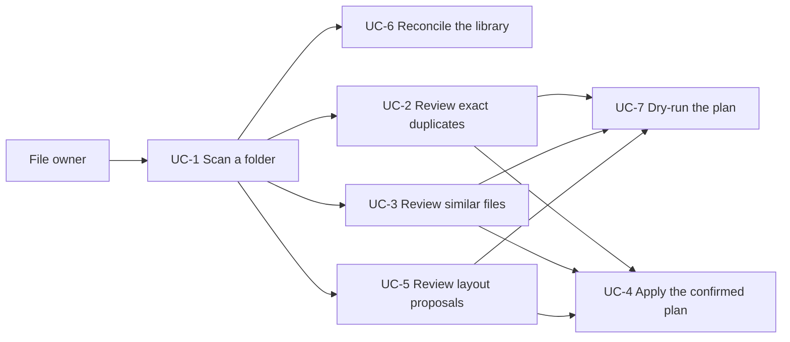
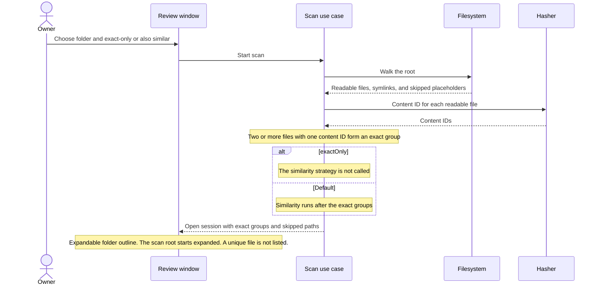
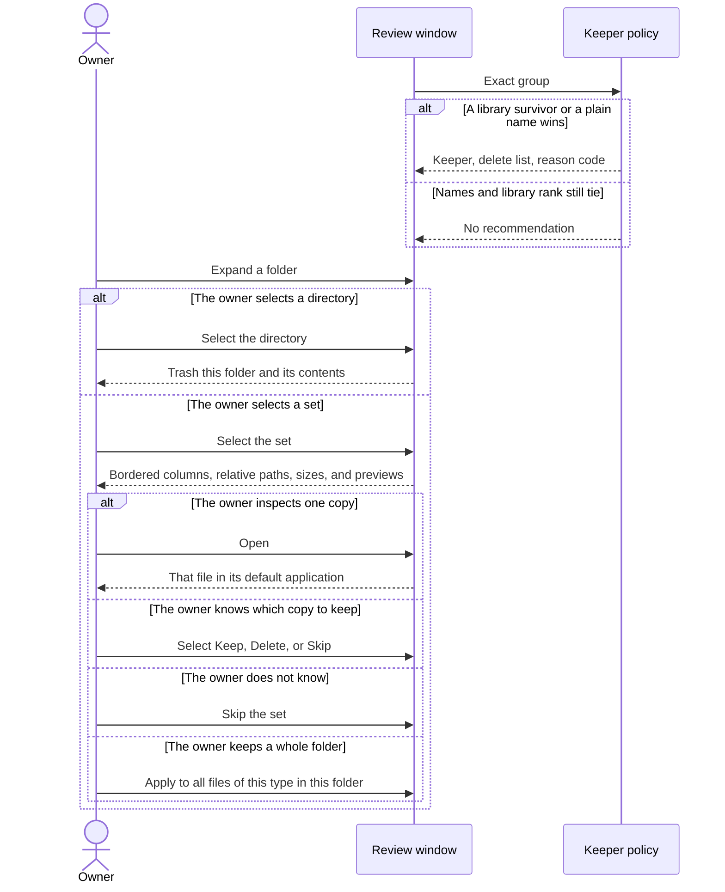
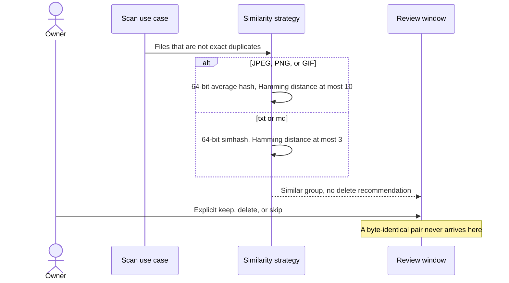
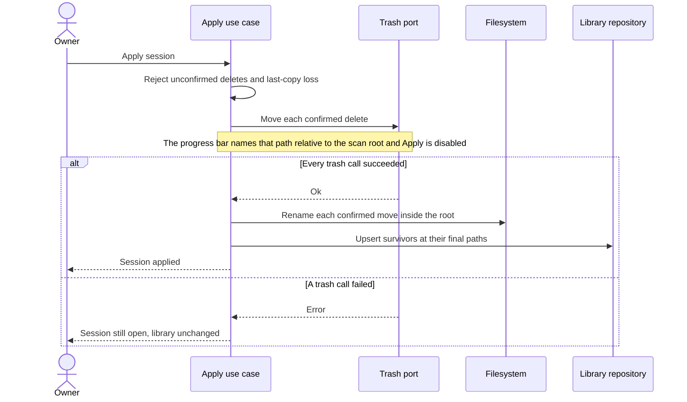
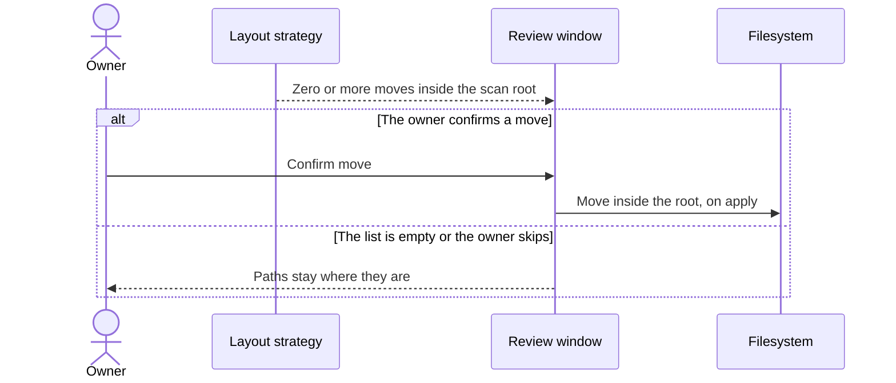
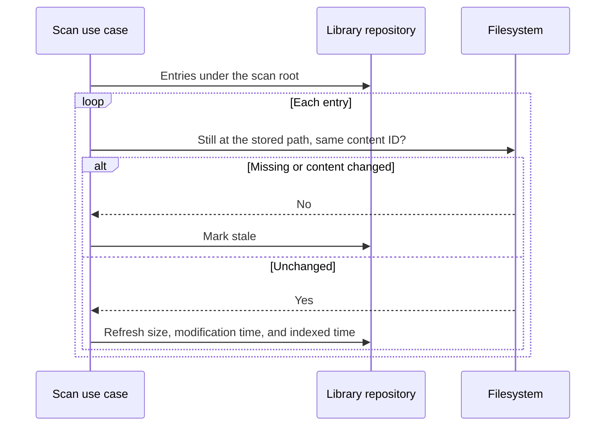
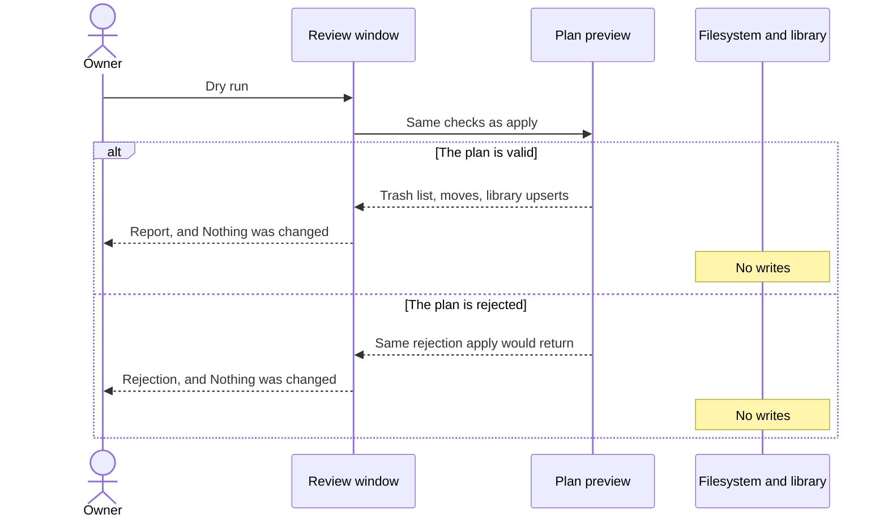

# Use cases

The person in these use cases is the owner of the files. The system is the hdsort process and the native review window it opens. Acceptance tests for each use case are listed in the prompt that implements it (`docs/development-plan.md`).

## UC-1 Scan a folder

The owner points hdsort at a folder. hdsort inventories the readable files, assigns content IDs, groups the files that share an ID, and opens a session. A content ID that appears once is not a group.

The walk does not follow symlinks, does not hash dataless placeholders, and skips `.git`, `node_modules`, Trash, and the hdsort data directory. Each symlink is listed on the session with the reason symlink and its destination. Dataless placeholders are listed too, so the owner can see that those paths were not compared.

Two readable files with the same bytes produce the same content ID, including two empty files. Two files that share a size and share the first and last 64 KiB but differ in the middle produce different content IDs. With exact-only off, near-duplicates continue into UC-3. With exact-only on, those near-duplicates stay ungrouped.

## UC-2 Review exact duplicates

The owner looks at exact groups. Each group is either given one recommendation or left without one when the keeper policy ties.

The recommendation the owner sees follows the rank in `docs/architecture.md`:

- A library survivor outside the folder is the keeper. The in-folder copies are the delete suggestion. The library file is not given a new path.
- Among copies that are all inside the folder, a name that is not a generated copy outranks `name (1)`, `Copy of name`, and a Dropbox `conflicted copy` name.
- When those signals tie, the newer modification time wins, and the reason code is `newer_mtime_tiebreak`. The reason text says that the time was only a tie-break.
- When the modification times also tie, there is no recommendation.

`report_v1.pdf` and `report_final.pdf` with different bytes do not form a group. With identical bytes they do, and the version words still do not pick the keeper.

The owner’s decision is stored against the file id. Open does not record a decision: it hands the copy’s cleaned absolute path to the default application. Keep, Delete, and Skip are radios. The selected radio is the recorded decision, or the suggestion when none is recorded. A tie leaves them clear. The path on a decision is the absolute path; the window draws that path relative to the scan root and draws the size in B, KB, MB, or GB. The left pane is an outline: the disclosure expands a directory, and the directory’s name selects it. Selecting a directory offers to trash that folder and everything inside it. That action calls Trash once and is not UC-4. It does not run the last-copy check and it does not write the library. A directory outside the scan root is refused. Selecting a set does not trash anything. Skip on a set records skip for every member. Applying the folder action records keep for every matching exact member in that folder and delete for members of those groups in other folders. It does not decide a similar group, and it does not decide an exact group of a different type.

When the scan root has a synced-folder path segment (`CloudStorage`, `Mobile Documents`, `Dropbox`, or `Google Drive`), the window shows the banner from `docs/architecture.md` before the owner confirms a delete.

## UC-3 Review similar files

The owner inspects files that are close but not byte-identical. The window shows them apart from exact groups and does not suggest which one to delete.

ADR-0010 fixes the fingerprints. The separation this use case already required stays: no recommended deletes, and no overlap with exact groups. The owner can still record an explicit delete on a similar-group member. A similar group leaves Keep, Delete, and Skip clear until the owner selects one. An exact-only scan (ADR-0011) does not enter this use case.

## UC-4 Apply the confirmed plan

The owner asks hdsort to carry out the decisions. hdsort checks the plan, moves confirmed deletes to Trash, renames confirmed moves inside the scan root, and only then records survivors at their final paths. While a file is moving to Trash, the progress bar names that path relative to the scan root and Apply is disabled. Dry run and Start scan stay enabled.

The last-copy rule: if the content ID is not already a valid library entry, the plan must leave at least one copy outside Trash. A library entry is valid when it has a content ID and a path and is not stale, and it keeps the content only when that path stays out of Trash. The owner can delete in-folder copies of a file the library already keeps.

A synced-folder banner does not block apply. It is shown in UC-2 so the confirmation happens with that warning already visible.

## UC-5 Review layout proposals

The owner sees a list of moves for the files that remain. The default strategy’s list is empty, so a folder that only needed deduplication shows no moves.

A proposal whose destination leaves the scan root is rejected and is not shown as a confirmable move. Confirming a move does not run it until UC-4 apply. After a successful apply, the library path is the destination path.

## UC-6 Reconcile the library

UC-1 runs this before it compares the folder with the library. Entries that point outside the folder are left alone. Entries that point inside the folder are checked against the disk.

A stale entry does not make the remaining files look like duplicates of a missing original. Two remaining copies still become an exact group by their own content IDs. One remaining copy is a survivor candidate, not a duplicate group.

## UC-7 Dry-run the plan

The owner asks the review window what the current decisions would do. hdsort runs the same checks as UC-4 and shows the Trash paths, the confirmed moves, and the library rows it would write. Files, Trash, and the library stay as they were. The session stays `open`. Apply remains a separate action.

A dry-run does not record a new decision and does not replace Apply.

## Out of scope for these use cases

- Calling a cloud provider API, or hydrating a dataless file so it can be hashed.
- Deleting without a decision recorded on that file id.
- Proposing a folder layout that moves files out of the scan root.
- Choosing a keeper from a similar group on the owner’s behalf.
